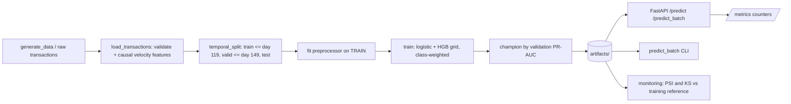

# Architecture and design decisions

## Data flow

## Decisions

**ADR-1 Temporal split.** Fraud patterns change over time, and a random split would let the
model see the future. Partitions are by day: train days 0 to 119, validation 120 to 149, test 150 to 179.

**ADR-2 Causal velocity features.** Counts of transactions in the last hour and day, and the
30-day mean amount, are computed from earlier transactions of the same card only. Tests check that
changing a later transaction does not change any earlier feature.

**ADR-3 Class weighting and cost-based threshold, not oversampling.** Fraud is about 0.6% of rows.
Models use balanced class weights. The threshold minimises expected cost on validation
data: 150 per missed fraud, 15 per false alarm. Both costs are stated assumptions in `src/config.py`.

**ADR-4 Champion by validation PR-AUC.** The candidates are compared on validation data
before the test set is used. The logistic regression is the champion in this run.

**ADR-5 Shared contract for online and batch.** Both paths use the same bounds
(`serving/schemas.py`), the same feature code (`src/features.py`) and the same scorer
(`serving/inference.py`).

**ADR-6 Four-tier degradation.** model, then rule engine, then a fail-safe prior that sends the transaction to manual review.

**ADR-7 Latency budget.** Each request is measured against `LATENCY_BUDGET_MS`. Slow requests are
counted and surfaced in `/metrics` and in the alert rules. The budget does not abort scoring.
